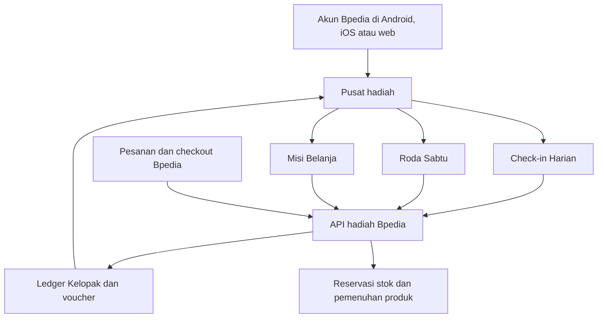

# Gambaran pengalaman Bpedia Kelopak

Pengguna masuk dari halaman hadiah Bpedia. Ia melihat saldo Kelopak dan tiga kegiatan. Check-in memberi alasan untuk kembali besok. Roda Sabtu memberi momen bermain singkat. Misi Belanja menghubungkan pesanan yang benar-benar selesai dengan manfaat pada pesanan berikutnya.

| Layar | Apa yang dilihat dan dilakukan pengguna | Hasil yang bisa diperiksa kembali |
|---|---|---|
| Check-in Harian | Lihat jejak tujuh hari, progres menuju produk gratis dan tombol check-in. Ketuk sekali untuk mengklaim. | Tambahan hari ini, bonus jika mencapai milestone, saldo terbaru, dan hak produk. |
| Roda Sabtu | Baca peluang tiap hadiah, sisa kuota dan ongkir. Putar sekali saat tersedia, atau lihat kapan dibuka. | Hasil tertulis dan bukti klaim yang tetap tersedia setelah animasi ditutup. |
| Misi Belanja | Lihat syarat tahap aktif dan progres pesanan. Buka voucher setelah hadiah terbit dan periksa minimal belanja berikutnya. | Status pesanan, voucher, aturan pemakaian, dan tahap berikutnya. |

## Arah visual

Gunakan latar Pearl, panel Blush, teks Plum dan tombol Berry. Bipy menyambut di area atas. Nominal dan syarat selalu berupa teks yang bisa dibaca pembaca layar. Gunakan satu tindakan utama per layar, area sentuh minimal 48 dp dan tata letak yang tetap terbaca saat teks diperbesar. Hasil roda juga tersedia bagi pengguna yang mengurangi gerakan atau mematikan suara.

## Batas rilis

Versi demonstrasi memakai data contoh. Rilis manfaat nyata memerlukan rekonsiliasi akun lintas platform, uji transaksi ganda, kuota dan pengiriman serta pengujian checkout pada lingkungan staging Bpedia. Pemilik backend dan aplikasi menyetujui aktivasi setelah bukti uji tersedia.
