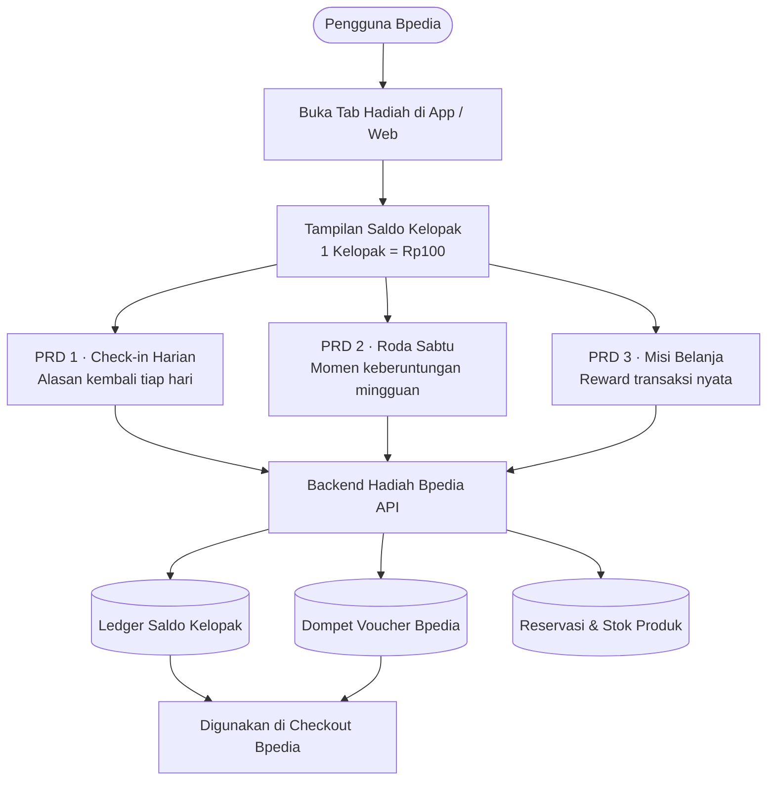
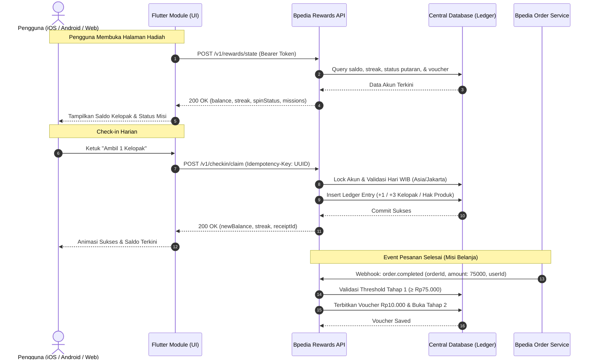

# Gambaran Arsitektur & Pengalaman Pengguna Bpedia Kelopak

Dokumen visual dan arsitektur resmi per 24 November 2026.
Dibaca bersama `PRD.md` dan `MEMORY.md` untuk memahami alur pengguna, sinkronisasi lintas platform, dan desain visual.

---

## 1. Perjalanan Pengguna (User Journey)

Pengguna masuk melalui menu **"Hadiah"** di aplikasi Bpedia (Play Store, App Store, maupun Web).
Satu dompet poin **Kelopak** menaungi ketiga kegiatan yang saling melengkapi:

---

## 2. Rincian Tiga Modul Utama

| Modul | Pengalaman Pengguna | Mekanisme & Syarat | Hasil & Bukti |
|---|---|---|---|
| **PRD 1: Check-in Harian** | • Melihat jejak 7 hari dan progres bulanan 30 hari. • Tombol satu ketuk: *"Ambil 1 Kelopak"*. • Berubah menjadi *"Sudah check-in hari ini"* jika sudah diklaim. | • Harian: +1 Kelopak (Rp100). • Hari ke-7 tanpa bolong: Bonus +3 Kelopak (Total 10 Kelopak = Rp1.000). • Hari ke-30 tanpa bolong: 1 Produk Gratis. • Bolong: reset ke hari 1. | Saldo Kelopak langsung bertambah di ledger server, nomor receipt tersimpan, progres bulanan tercatat. |
| **PRD 2: Roda Sabtu (Gacha)** | • Hanya aktif pada hari Sabtu WIB. • Pengguna melihat tabel peluang (%) dan kuota stok secara transparan sebelum memutar. • Tombol *"Putar Gratis"* (1x per Sabtu). | • Hadiah: Produk Gratis atau Kelopak (3 Kelopak). • Kuota stok riil. • Ongkir dicantumkan jelas (Rp0 pada promo/demo). | Hasil diputuskan server (RNG server), animasi roda berputar dan berhenti sesuai hasil server. Anti-kecurangan. |
| **PRD 3: Misi Belanja (Suf)** | • Melihat daftar misi belanja bertingkat. • Tahap 1 aktif: *"Selesaikan 1 pesanan ≥ Rp75.000"*; Tahap 2 terkunci. • Notifikasi voucher terbit setelah pesanan selesai. | • Belanja ≥ Rp75.000 (status selesai) → Voucher Rp10.000. • Syarat pakai voucher: Min. belanja Rp100.000 di pesanan berikutnya. • Setelah Tahap 1 selesai → Tahap 2 otomatis terbuka. | Voucher personal diterbitkan ke akun pengguna, siap dipasang saat checkout pesanan berikutnya. |

---

## 3. Arsitektur Sinkronisasi Lintas Platform

Semua status disimpan secara terpusat di server backend Bpedia. Perangkat pengguna (iPhone, Android, dan Browser Web) hanya berfungsi sebagai *presentation layer*.

---

## 4. Panduan Desain & Aksesibilitas (Design System)

| Elemen | Nilai / Kode Warna | Peruntukan |
|---|---|---|
| **Pearl** | `#FFFDFD` | Warna latar belakang utama (bersih, luas, ramah mata). |
| **Blush** | `#F9F0EF` | Warna panel kartu, container modul, dan penanda hari yang belum aktif. |
| **Blush Soft** | `#F6CFDA` | Penanda hari check-in yang sudah berhasil dicapai. |
| **Berry (Primary)** | `#982149` | Tombol aksi utama (CTA), ikon aktif, dan sorotan progres. |
| **Plum (Text)** | `#4B1C2E` | Teks judul dan tulisan utama (kontras tinggi, terbaca jelas). |
| **Gold / Ochre** | `#EAA023` | Aksen hadiah spesial (kado hari ke-7, ikon produk gratis). |
| **Maskot Bipy** | Maskot lebah resmi Bpedia | Menyambut di bagian header atas dengan pose ramah (`maskot pose hai.png`). |

### Aturan Aksesibilitas Wajib:
1. **Target Sentuh**: Semua tombol dan area interaktif memiliki ukuran minimal **48 × 48 dp**.
2. **Pembaca Layar (Screen Reader)**: Setiap komponen membungkus informasinya dengan widget `Semantics` sehingga tuna netra pengguna TalkBack/VoiceOver mendapatkan deskripsi teks yang jelas (misal: *"Hari 1, tercapai"*, *"Peluang produk gratis 10 persen"*).
3. **Mode Kurangi Gerakan (*Reduce Motion*)**: Saat sistem operasi mengaktifkan fitur *Reduce Motion*, animasi putaran roda roulette otomatis ditiadakan dan langsung menampilkan hasil akhir.
4. **Respon Galat Mandiri**: Jika koneksi jaringan terputus, sediakan tombol *"Coba Lagi"* yang memuat ulang status dari server secara aman tanpa risiko duplikasi transaksi.
