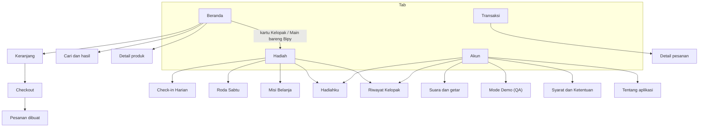
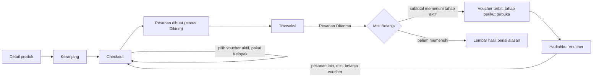
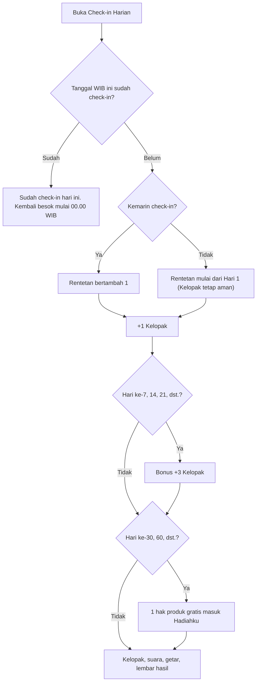
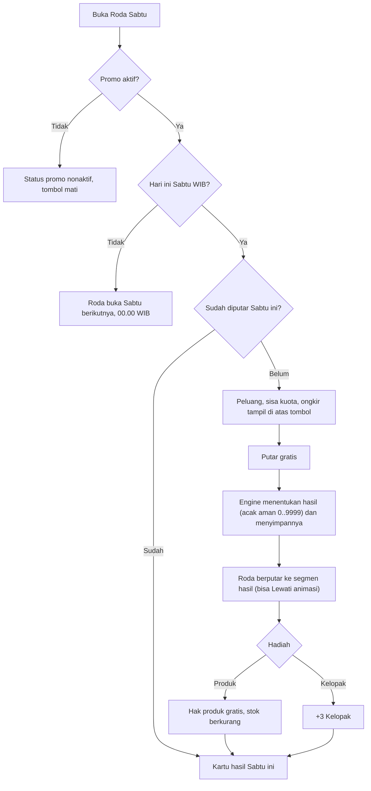
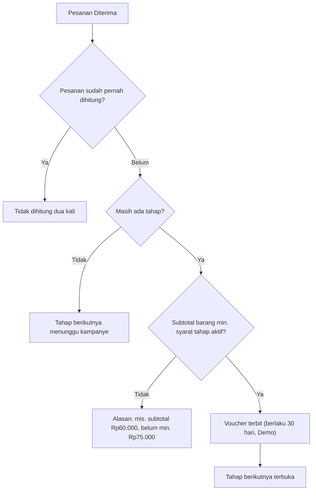
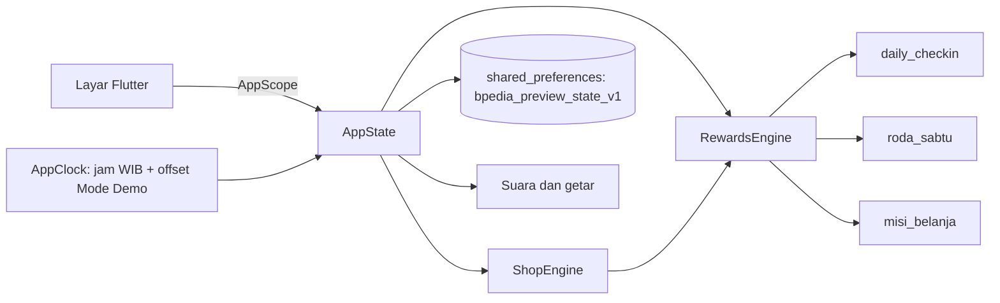
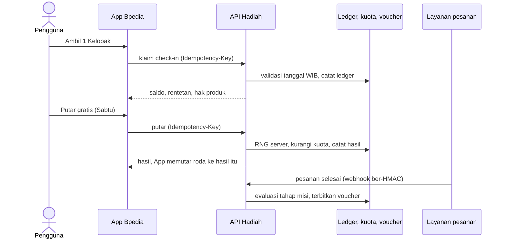

# Gambaran · Bpedia Preview v2

Alur pengguna, daftar layar, dan arah visual Bpedia Preview per 24 Nov 2026. Detail tiap layar ada di `docs/SPEC-UIUX.md`; aturan bisnis di `docs/SPEC-CONTRACT.md`.

Tujuan UX: belanja dan main hadiah terasa nyaman dan tidak membingungkan. Setiap layar menjawab: *saya di mana, apa yang bisa saya lakukan sekarang, apa yang terjadi setelahnya.*

---

## 1. Peta navigasi

Empat tab dengan label selalu tampil. Layar lain dibuka di atas tab (tombol kembali Android di tab selain Beranda kembali ke Beranda).

Titik merah di tab Hadiah muncul bila check-in hari ini belum diambil atau Roda Sabtu siap diputar.

## 2. Perjalanan utama: belanja, misi, voucher

## 3. Alur tiap game

### Check-in Harian

Visual "Kebun Bipy": 7 tulip; kuncup = belum, mekar = sudah, slot hari ini berdenyut halus, slot 7 = kado bonus +3. Di bawahnya progres 30 hari menuju produk gratis.

### Roda Sabtu

Segmen roda sebanding peluang. Bila stok produk habis, peluang produk 0% dan hadiah selalu Kelopak. Hasil tetap tertulis setelah app dibuka ulang.

### Misi Belanja

Tangga misi: Tahap 1 (Selesai/Aktif), Tahap 2 (Terkunci sampai voucher tahap 1 terbit), lalu "Tahap berikutnya menunggu kampanye". Voucher tidak bisa dipakai di pesanan sumbernya.

## 4. Alur data di Bpedia Preview (Mode Demo)

Semua aturan dihitung fungsi modul; engine hub hanya mencatat hasilnya. Tidak ada jaringan.

## 5. Target produksi (belum dibangun)

State terikat akun Bpedia, bukan perangkat. Klien hanya menampilkan.

## 6. Daftar layar

| Layar | Isi utama | Tindakan utama | File |
|---|---|---|---|
| Beranda | Cari, kartu Kelopak hari ini, "Main bareng Bipy" (3 tile dengan status), kategori, Hot Item, produk | Ambil 1 Kelopak (bila belum) | `lib/ui/home/home_page.dart` |
| Cari | Hasil cari + filter kategori | Buka produk | `lib/ui/shop/search_page.dart` |
| Detail produk | Foto, nama, harga + coret, info misi aktif | Tambah ke keranjang | `lib/ui/shop/product_page.dart` |
| Keranjang | Item + stepper, hapus dengan Urungkan, progres misi | Checkout | `lib/ui/shop/cart_page.dart` |
| Checkout | Alamat demo, Gratis ongkir (Demo), voucher, Pakai Kelopak, rincian | Bayar sekarang (simulasi) | `lib/ui/shop/checkout_page.dart` |
| Pesanan dibuat | Bipy dalam tas + nomor pesanan | Lihat pesanan | `lib/ui/shop/order_success_page.dart` |
| Hadiah | Saldo besar, kartu Check-in, Roda Sabtu, Misi Belanja, Hadiahku | Ambil 1 Kelopak (langsung di kartu) atau Lihat roda (Sabtu) | `lib/ui/rewards/rewards_hub_page.dart` |
| Check-in Harian | Kebun Bipy 7 hari, progres 30 hari, peringatan rentetan putus | Ambil 1 Kelopak | `lib/ui/rewards/checkin_page.dart` |
| Roda Sabtu | Status, roda, tabel peluang + kuota + ongkir, kartu hasil; bar bawah: ringkasan peluang + tombol | Putar gratis | `lib/ui/rewards/wheel_page.dart` |
| Misi Belanja | Tangga tahap, syarat, pesanan yang menunggu, voucher saya | Belanja sekarang | `lib/ui/rewards/missions_page.dart` |
| Hadiahku | Tab Voucher dan Produk gratis | Pakai voucher | `lib/ui/rewards/my_rewards_page.dart` |
| Riwayat Kelopak | Ledger: tanggal WIB, keterangan, +/−, saldo berjalan | (baca) | `lib/ui/rewards/ledger_page.dart` |
| Transaksi | Filter Semua / Dikirim / Selesai, kartu pesanan | Buka detail | `lib/ui/orders/orders_page.dart` |
| Detail pesanan | Rincian, status, hasil misi | Pesanan Diterima | `lib/ui/orders/order_detail_page.dart` |
| Akun | Profil "Pengguna Demo" + saldo, Hadiahku, Riwayat Kelopak, Suara & getar, Tampilan, Mode Demo (QA), S&K, Tentang | (menu) | `lib/ui/account/account_page.dart` |
| Suara & getar | Switch Efek suara, Musik latar (bawaan mati), Getar | (switch) | `lib/ui/account/sound_settings_page.dart` |
| Mode Demo (QA) | Tanggal simulasi, +1/+7 hari, lompat ke Sabtu, promo roda, stok roda, reset | (alat uji) | `lib/ui/account/demo_tools_page.dart` |
| Syarat & Ketentuan | Kelopak, Check-in, Roda Sabtu (peluang, kuota, ongkir, disclaimer Apple/Google), Misi Belanja, Mode Demo | (baca) | `lib/ui/account/terms_page.dart` |
| Tentang aplikasi | Logo, versi, penjelasan prototipe, tautan resmi | Unduh app Bpedia resmi | `lib/ui/account/about_page.dart` |

Setiap keadaan didesain: kosong (Bipy ngintip + langkah berikutnya), siap, selesai, dan nonaktif dengan alasan.

## 7. Arah visual

### Warna (token brand, `lib/core/tokens.dart`)

| Token | Terang | Gelap (Berry Night) | Dipakai untuk |
|---|---|---|---|
| pink-600 | `#D81F57` | `#FF7AA0` | tombol utama, tautan |
| berry-700 | `#B3164B` | `#F9A2C1` | harga, ikon aksen |
| plum-900 | `#45122B` | `#FDEAF0` | teks utama |
| ink-700 | `#6E4556` | `#E7C9D4` | teks sekunder |
| pearl-50 | `#FFF7F8` | `#2A0A18` | latar halaman |
| blush-100 | `#FDE7EC` | `#3B1026` | panel, chip aktif |
| white / card | `#FFFFFF` | `#3B1026` | kartu, input |
| line | `#F3D3DD` | `#5A1A36` | garis kartu dan pemisah |
| honey-400 | `#F5B83D` | `#F5B83D` | aksen hadiah, badge terlaris |

Proporsi 60·30·10: pearl/putih sebagai latar, blush/tulip untuk panel, pink/berry hanya untuk CTA dan harga. Status selalu teks + ikon, tidak hanya warna. Teks putih tidak dipakai di atas petal `#F7729A`.

Di Berry Night, blush-100 sama dengan warna kartu, jadi isian di atas kartu (chip aktif, pill status, segmen terpilih, tile jejak check-in) memakai pink-200 gelap `#5A1A36`; `secondaryContainer` setingkat lebih terang (`#6A2542`) supaya segmen roda yang berselang-seling tetap terlihat beda. Chip aktif selalu bergaris dan berlabel Berry.

### Tipografi dan bentuk

- Poppins: display 28/34 w700, title 22/28 w600, headline 18/24 w600, body 16/24, body-s 14/20, caption 12/16 w500, tombol 16/20 w600, harga 18/24 w800 (berry). Fraunces italic hanya untuk tagline "Belanja Bikin Bahagia.". Tanpa ALL CAPS.
- Radius 6 / 10 / 16 / 24 / 40 / pil. Kartu radius 16 + garis 1,5 px + bayangan lembut; sheet radius 24; tombol pil tinggi 52 (addendum brand §7).
- Grid 8 pt: margin layar 16, jarak antar-section 32, jarak antar-kartu kecil 12. Konten transaksi maks. 560 dp di layar lebar.
- Satu tombol utama (pink penuh) per layar; tindakan lain berupa tombol outline atau teks.

### Ikon dan maskot

- Set ikon SVG brand (grid 24, stroke 1,8): versi mono untuk tab bar dan UI padat, versi berwarna untuk konten. Tab Transaksi memakai ikon struk (`bpedia-ikon-transaksi`) yang digambar dengan aturan yang sama; ikon tas khusus untuk keranjang.
- **Bipy** adalah gadis chibi bertudung tulip pink. Satu Bipy per layar, di sepertiga kanan atau pojok bawah, tidak menutupi harga atau nama produk. Hanya render resmi.

| Pose | Berkas | Untuk |
|---|---|---|
| Wink | `bipy_wink.webp` | sapaan, avatar, default |
| Senyum | `bipy_senyum.webp` | info, S&K, bantuan |
| Ngintip | `bipy_ngintip.webp` | keadaan kosong |
| Dalam tas | `bipy_tas_hati.webp`, `bipy_tas_depan.webp` | promo, misi belanja, pesanan |
| Berdiri | `bipy_berdiri.webp` | edukasi, cara kerja |
| Menyapa | `bipy_menyapa.webp` | sambutan, header Hadiah |

### Suara, gerak, dan copy

| Peristiwa | Visual | Suara | Getar |
|---|---|---|---|
| Check-in biasa | ledakan kelopak kecil | `claim` | ringan |
| Bonus hari ke-7 | ledakan + badge "+3" | `bonus` | sedang |
| Produk gratis | konfeti kelopak + kado 3D | `win_product` | kuat |
| Roda mulai / pasak | putaran ease-out | `spin_start` / `tick` (maks. 25/detik) | klik (maks. 12/detik) |
| Voucher terbit | kartu voucher muncul | `unlock` | ringan |
| Tidak memenuhi | ikon info + alasan | `soft_error` | tidak ada |

- Semua animasi dilewati bila "kurangi gerakan" aktif. Musik latar hanya di tab Hadiah dan layar game, bawaan mati. Suara tidak menghentikan musik app lain.
- Voice: hangat, ceria, jujur. Sapa "Babes" di momen sapaan dan sukses. Tanpa hard-sell, tanpa klaim "memutihkan/menyembuhkan/permanen/100%", tanpa emoji. Angka Kelopak selalu dengan nilai rupiahnya: "10 Kelopak (Rp1.000)".
