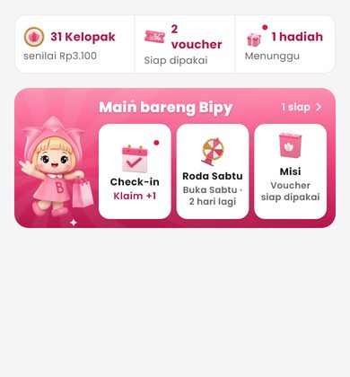
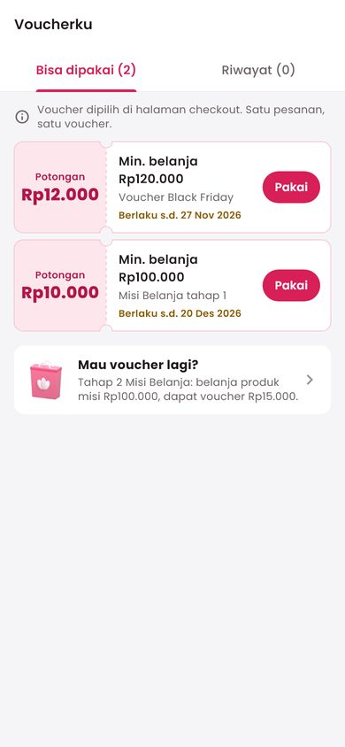
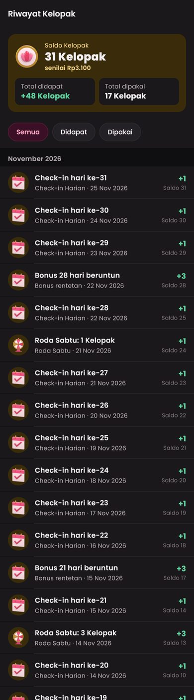
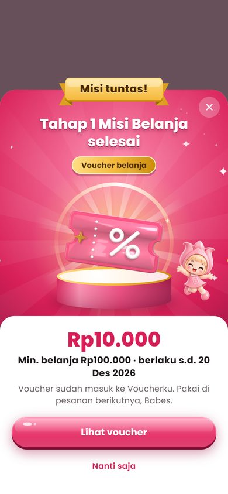

# kelopak_hub · sistem Kelopak dan zona Hadiah (Bpedia Demo v3)

Paket Flutter murni (tanpa plugin) untuk poin **Kelopak** Bpedia (1 Kelopak = Rp100) dan tiga game hadiahnya:

- **Check-in Harian**: +1 Kelopak per hari WIB, bonus +3 tiap hari ke-7 beruntun, produk gratis di hari ke-30.
- **Roda Sabtu**: 1 putaran gratis tiap Sabtu WIB; hadiah produk (kuota) atau Kelopak, peluang tampil sebelum memutar.
- **Misi Belanja**: belanja produk misi dalam satu pesanan yang diterima, dapat voucher untuk pesanan berikutnya; bertahap.

Isi paket: mesin aturan, buku besar, kutipan checkout (Kelopak memotong harga, K16), hadiah menunggu yang ikut pesanan berikutnya (K17), backend lokal + kontrak server, **zona Hadiah** (`/hadiah/*`), controller sungguhan untuk halaman tiga modul game, dan widget tanam untuk Beranda aplikasi. Dipakai oleh `bpedia-app`.

| | |
|---|---|
| Versi | 3.0.0 |
| Dependensi | Flutter SDK, `daily_checkin`, `roda_sabtu`, `misi_belanja` (path, repo bersebelahan) |
| Flutter | 3.41.7 / Dart 3.11.5 |

## Tangkapan layar

| Zona Hadiah (terang) | Zona Hadiah (gelap) | Widget tanam Beranda |
|---|---|---|
|  |  |  |

| Hadiahku | Voucherku | Riwayat Kelopak | Misi tuntas |
|---|---|---|---|
|  |  |  |  |

Semua tangkapan dibuat ulang dengan `flutter test test/shots` (PNG di `build/shots/`, terang dan gelap).

## Pakai

```dart
import 'package:kelopak_hub/kelopak_hub.dart';

final controller = await KelopakController.open(
  backend: LocalKelopakBackend(store: MemoryKeyValueStore(), campaign: myCampaign),
  host: myHost, // implements KelopakHost (+ KelopakGameActions opsional)
);

runApp(KelopakScope(
  controller: controller,
  child: MaterialApp(
    routes: kelopakRoutes, // /hadiah, /hadiah/checkin, /hadiah/roda, /hadiah/misi, /hadiah/hadiahku, /hadiah/voucher, /hadiah/riwayat
    home: const MyHome(),  // KelopakWalletStrip(), KelopakGameStrip() di Beranda
  ),
));
```

API lengkap, bentuk data, dan endpoint backend: `docs/SPEC-CONTRACT.md`. Langkah integrasi: `HANDOFF-PENGEMBANG.md`. Produk: `PRD.md`.

## API publik utama

| Kelompok | Nama |
|---|---|
| Inti | `KelopakController`, `KelopakScope`, `KelopakHost`, `KelopakGameActions`, `KelopakEvent`, `KelopakCampaign`, `KelopakPolicy`, `KelopakProduct`, `WibClock` |
| Backend | `KelopakBackend`, `LocalKelopakBackend`, `RemoteKelopakBackend`, `KelopakTransport`, `KelopakAction` |
| Checkout | `CheckoutRequest`, `CheckoutLine`, `CheckoutQuote`, `CheckoutProblem`, `KelopakOrder` |
| Halaman | `RewardsHubPage`, `MyGiftsPage`, `VouchersPage`, `LedgerPage`, `showKelopakHowTo`, `kelopakRoutes`, `kelopakRouteFor`, `KelopakNavigation`, `KelopakPaths` |
| Game | `KelopakCheckInScreen`, `KelopakWheelScreen`, `KelopakMissionScreen`, `KelopakCheckInController`, `KelopakWheelController`, `KelopakMissionController`, `KelopakGameStatus` |
| Tanam | `KelopakWalletStrip`, `KelopakGameStrip`, `MissionCompleteCelebration`, `showMissionCompleteCelebration` |
| Komponen | `VoucherTicket`, `LedgerTile`, `GiftProductImage`, `GiftStatusChip`, `HubArt`, `kelopakPreviewTheme` |
| Kit | `package:kelopak_hub/kit.dart`: kit pesta (`CandyButton`, `GameScaffold`, `ResultSheet`, konfeti, koin terbang, sprite) + `BipySprite`, `BipySprites` |

## Contoh

`example/` menjalankan Beranda tiruan (strip dompet + "Main bareng Bipy"), zona Hadiah, tiga game, toko dan keranjang sederhana, dan panel demo (masuk/tamu, tema, kurangi gerak, geser hari, ke Sabtu, isi saldo, kuota roda, pesanan, atur ulang).

```bash
cd example
flutter create --platforms=web,android .   # sekali, membuat runner
flutter run -d chrome
```

## Gerbang mutu

```bash
flutter analyze
flutter test --concurrency=3
cd example && flutter test
```

## Struktur

```
lib/
  kelopak_hub.dart          barel publik
  kit.dart                  kit pesta + BipySprite
  src/core, domain, storage, backend, controller, host   mesin dan data (H1)
  src/games                 controller tiga game di atas KelopakController
  src/ui                    zona Hadiah dan halaman turunannya
  src/embed                 widget tanam untuk host
  src/kit                   salinan kit pesta (jangan diubah di sini)
assets/art, bipy, fx        seni 3D, Bipy, stiker
example/                    app contoh
test/                       domain, storage, backend, controller, ui, shots
docs/                       kontrak, riset, tangkapan layar
server/                     simulator PHP v2
```
