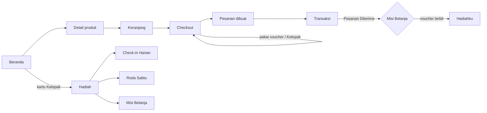

# Spesifikasi UI/UX v2 · Bpedia Preview

Tujuan: belanja dan main hadiah terasa **nyaman, jelas, tidak membingungkan**. Setiap layar menjawab tiga pertanyaan: *saya di mana, apa yang bisa saya lakukan sekarang, apa yang terjadi setelahnya*.

## 1. Prinsip

1. **Satu tindakan utama per layar** (tombol pink penuh). Tindakan lain berupa tombol teks/outline.
2. **Bahasa sederhana**: "Ambil 1 Kelopak", "Putar gratis", "Pakai voucher". Hindari istilah teknis (klaim, redeem, entitlement).
3. **Angka selalu lengkap**: Kelopak ditulis bersama nilai rupiahnya: "10 Kelopak (Rp1.000)".
4. **Status selalu teks + ikon**, tidak hanya warna. Contoh: ikon centang + "Sudah check-in hari ini".
5. **Selalu ada langkah berikutnya**: "Kembali besok mulai 00.00 WIB untuk Hari ke-4". Tidak ada jalan buntu.
6. **Aturan bisa dibuka di tempat**: tiap game punya tombol "Cara kerja" (bottom sheet) berisi aturan lengkap.
7. **Tanpa pop-up paksa saat app dibuka.** Ajakan check-in cukup satu kartu di Beranda.
8. **Umpan balik terasa**: sukses = animasi kelopak + suara + getar ringan + lembar hasil yang bisa ditutup. Gagal = suara lembut + pesan + tombol pemulihan.
9. **Hormati preferensi**: kurangi gerakan (animasi dilewati), suara bisa dimatikan (Akun > Suara & getar), mode gelap mengikuti sistem.
10. **Aksesibel**: target sentuh 48 dp, label Semantics, teks bisa diperbesar sampai 200% tanpa terpotong (tanpa tinggi tetap pada wadah teks).
11. **Jujur soal demo**: chip "DEMO" kecil di AppBar layar Hadiah & Checkout; semua data di perangkat.

### Keputusan dari audit UX app saat ini (screenshot owner, 24 Nov 2026)

| Masalah di app/mockup lama | Keputusan v2 |
|---|---|
| Dua-tiga mata uang ("Koin Bipy", "Kelopak", koin bintang) | **Kelopak satu-satunya mata uang** di semua label, ikon, copy. Token 3D kelopak dipakai konsisten. |
| Check-in bisa dilakukan di "Daily Check-in" dan "Kebun Bipy" | **Kebun Bipy dilebur ke Check-in Harian** sebagai visual: 7 tulip yang mekar per hari check-in. Satu tombol check-in saja. |
| Gacha lewat tile + pop-up, tanpa jadwal/odds; 2 dari 6 segmen "Produk gratis" | Satu pintu masuk. Nama fitur **Roda Sabtu**. Segmen roda **sebanding peluang**. Odds + kuota + ongkir tampil sebelum tombol. Tanpa pop-up. |
| Tile game tanpa status | Tile & kartu selalu menampilkan status (Siap diambil / Buka Sabtu, 2 hari lagi / Tahap 1 · 0 dari 1). |
| Hub game di dalam "EVENT PROMO" | Section sendiri "Main bareng Bipy" + tab **Hadiah**. |
| Kartu "Menunggu Pembayaran Rp. 0" selalu tampil, typo "di bayarkan" | Dihapus dari Beranda. Ringkasan pesanan hanya di tab Transaksi. |
| Pop-up interstisial menutup Beranda | Tidak ada pop-up saat app dibuka. |
| Kartu produk ramai (teks/badge tercetak di foto), tanpa tombol keranjang | Packshot bersih 1:1; badge (diskon, Hot Item) dirender UI; anatomi: foto, nama 2 baris, harga final + coret + %, tombol "+ Keranjang" 48 dp. |
| Bahasa campur & banyak nama per fitur ("Daily Sign In", "Daily Check-in", …) | Glosarium tunggal: **Check-in Harian, Roda Sabtu, Misi Belanja, Kelopak, Hadiahku, Voucher**. Sentence case. "Sign In" tidak dipakai. |
| Format uang/satuan tidak konsisten ("Rp 10.000", "Rp. 0", "20Ml") | Satu formatter: `Rp10.000`. Satuan: `20 ml`, `10 g`. |
| Ikon status bar putih di atas pink muda; tab nonaktif kontras rendah | `SystemUiOverlayStyle.dark` di tema terang; label tab nonaktif `ink-700` (kontras ≥ 4,5:1). |
| Misi hanya satu tingkat, tanpa masa berlaku | Tangga misi bertahap + masa berlaku voucher + S&K. |

## 2. Arsitektur informasi

Bottom navigation 4 tab, label selalu tampil:

| Tab | Isi | Menggantikan |
|---|---|---|
| **Beranda** | Cari, ringkasan Kelopak + aksi hari ini, "Main bareng Bipy" (3 game), kategori, Hot Item, Produk | Beranda lama (lebih ringkas; daftar transaksi dipindah) |
| **Hadiah** | Saldo Kelopak besar, 3 kartu game dengan status, Hadiahku (voucher & produk gratis), Riwayat Kelopak, Cara kerja | Event promo yang tersembunyi |
| **Transaksi** | Filter Semua / Dikirim / Selesai, daftar pesanan, detail + "Pesanan Diterima" | Tab Transaksi |
| **Akun** | Profil demo, Hadiahku, Riwayat Kelopak, Suara & getar, Tampilan, Mode Demo (QA), Syarat & Ketentuan, Tentang | Tab Akun + tab "Menu" yang ambigu |

Keranjang: ikon tas di kanan atas Beranda (badge jumlah). Tidak ada ikon notifikasi (tidak ada fitur = jalan buntu).

## 3. Layar

### 3.1 Beranda
- AppBar: logo Bpedia horizontal (kiri), ikon keranjang + badge (kanan).
- Kolom cari (placeholder "Cari skincare, makeup, lashes…") membuka halaman hasil dengan filter kategori.
- **Kartu Kelopak hari ini** (satu kartu, berubah sesuai keadaan):
  - belum check-in: token 3D + "12 Kelopak (Rp1.200)" + tombol "Ambil 1 Kelopak" langsung dari Beranda.
  - sudah: "Sudah check-in · Hari ke-4 beruntun" + "Lihat hadiah".
  - Sabtu & belum putar: tambahan baris "Roda Sabtu siap diputar".
- **Main bareng Bipy**: 3 tile (Check-in, Roda Sabtu, Misi Belanja), masing-masing dengan sublabel status: "Siap diambil" / "Buka Sabtu" / "Tahap 1 · 0 dari 1 pesanan".
- Kategori: chip ikon brand (Skincare, Bodycare, Makeup, Haircare, Fragrance, Lashes, Tools).
- Hot Item: carousel horizontal kartu produk dengan badge diskon.
- Produk: grid 2 kolom (3 kolom bila lebar > 600 dp).

### 3.2 Detail produk
Foto (label kecil "Foto ilustrasi" di Mode Demo), nama, harga (berry-700 w800) + harga coret, badge Original, deskripsi singkat, info misi aktif ("Belanja min. Rp75.000 untuk voucher Rp10.000"). Bar bawah: stepper jumlah + "Tambah ke keranjang" (utama).

### 3.3 Keranjang & Checkout
- Keranjang: daftar item (stepper, hapus dengan konfirmasi undo snackbar), subtotal, progres misi ("Tambah Rp12.000 lagi untuk ikut Misi Belanja tahap 1"), tombol "Checkout".
- Checkout: alamat demo, pengiriman "Gratis ongkir (Demo)", **Voucher** (pilih dari voucher aktif; yang belum memenuhi syarat tampil abu-abu dengan alasan "Belanja Rp8.000 lagi"), **Pakai Kelopak** (switch; maks. 50% subtotal, Demo), rincian harga (subtotal, voucher, Kelopak, total), tombol "Bayar sekarang (simulasi)".
- Sukses: Bipy + "Pesanan dibuat" + nomor pesanan + "Lihat pesanan". Pesanan berstatus **Dikirim**.

### 3.4 Transaksi
Filter chip. Kartu pesanan: nomor, tanggal WIB, jumlah item, total, status (ikon + teks). Detail: rincian, timeline status, tombol **"Pesanan Diterima"** (utama, hanya saat Dikirim) → status Selesai → engine misi → lembar hasil ("Misi tahap 1 selesai! Voucher Rp10.000 masuk ke Hadiahku" atau alasan tidak memenuhi, mis. "Subtotal Rp60.000, belum mencapai min. Rp75.000").

### 3.5 Hadiah (hub)
Header: latar kelopak (gambar header) memudar ke pearl, Bipy menyapa, saldo besar "12 Kelopak", "Setara Rp1.200", tautan "Riwayat". Kartu:
1. **Check-in Harian**: jejak 7 hari mini + tombol/teks status.
2. **Roda Sabtu**: status (Siap / Sudah diputar, hasil: … / Buka Sabtu 29 Nov, 00.00 WIB) + "Lihat peluang".
3. **Misi Belanja**: tahap aktif + syarat + progres.
4. **Hadiahku**: jumlah voucher aktif & produk gratis.
Footer: "Cara kerja Kelopak".

### 3.6 Check-in Harian
Hero Bipy + "Hari ke-3 beruntun". `CheckInWeekTrack` bertema **Kebun Bipy**: 7 slot tulip (kuncup = belum, mekar = sudah, slot hari ini berdenyut halus, slot 7 = kado bonus +3), tombol `CheckInClaimButton`. Setelah klaim: ledakan kelopak (≤ 900 ms), suara `claim` (atau `bonus` di hari ke-7/14/…, `win_product` di hari ke-30), getar ringan, lembar hasil: "+1 Kelopak" / "+1 Kelopak + bonus 3 Kelopak" / "+ 1 produk gratis", saldo baru. `CheckInMonthProgress` menuju produk gratis hari ke-30. Peringatan lembut bila rentetan putus: "Rentetanmu mulai lagi dari Hari 1. Kelopak yang sudah kamu kumpulkan tetap aman." Cara kerja: aturan lengkap + tabel contoh (hari 1 = 1, hari 7 = 10 total, hari 30 = 42 total + produk).

### 3.7 Roda Sabtu
Status di atas roda (Siap diputar / Buka Sabtu, 29 Nov · 00.00 WIB, sisa x hari / Sudah diputar Sabtu ini). `SaturdayWheel` dengan segmen sebanding peluang. **`OddsTable` tampil di atas tombol** (peluang %, sisa kuota produk, ongkir). Tombol "Putar gratis" hanya aktif bila tersedia. Selama berputar: tombol berubah "Lewati animasi". Suara `spin_start`, `tick` per pasak (dibatasi ≤ 25/detik), lalu `claim`/`win_product`. Hasil tetap tertulis di kartu hasil setelah animasi (dan setelah app dibuka ulang). S&K: penyelenggara, gratis tanpa pembelian, periode Sabtu WIB, peluang, stok, ongkir, "Apple bukan sponsor dan tidak terlibat dalam promosi ini", "Google bukan sponsor…".

### 3.8 Misi Belanja
`MissionLadder` vertikal: Tahap 1 (Selesai/Aktif), Tahap 2 (Terkunci sampai voucher 1 terbit), lalu "Tahap berikutnya menunggu kampanye". Kartu tahap aktif: syarat, hadiah, aturan voucher, status pesanan terkait (pesanan Dikirim yang akan memenuhi syarat ditampilkan "Menunggu pesanan diterima"). CTA "Belanja sekarang". Bagian "Voucher saya" memakai `VoucherCard` (Aktif / Terpakai / Kedaluwarsa).

### 3.9 Hadiahku & Riwayat Kelopak
Hadiahku: tab Voucher | Produk gratis (hak dari check-in hari ke-30 & roda; status "Menunggu pengiriman (Demo)"). Riwayat: daftar ledger (tanggal WIB, keterangan, +/−, saldo berjalan), kosong = Bipy ngintip + "Ambil Kelopak pertamamu".

### 3.10 Akun
Profil "Pengguna Demo". Menu: Hadiahku, Riwayat Kelopak, Suara & getar (SFX on/off, musik latar on/off default off, getar on/off), Tampilan (Ikuti sistem / Terang / Gelap), **Mode Demo (QA)**: tanggal WIB simulasi, +1 hari, +7 hari, Lompat ke Sabtu berikutnya, Promo Roda aktif (switch), Isi ulang stok produk roda, Reset semua data (konfirmasi). Syarat & Ketentuan Program, Tentang (versi, "Prototipe clean-room Bpedia, data demo di perangkat").

## 4. Umpan balik

| Peristiwa | Visual | Suara | Getar |
|---|---|---|---|
| Ketuk tombol utama | ripple | `tap` (opsional, hanya di layar game) | selectionClick |
| Check-in biasa | ledakan kelopak kecil | `claim` | lightImpact |
| Bonus hari ke-7 | ledakan + badge "+3" | `bonus` | mediumImpact |
| Produk gratis | konfeti kelopak + kado 3D | `win_product` | heavyImpact |
| Roda mulai / pasak | — | `spin_start` / `tick` | selectionClick (≤ 12/dtk) |
| Voucher terbit | kartu voucher muncul | `unlock` | lightImpact |
| Gagal/tidak memenuhi | ikon info | `soft_error` | — |

Semua animasi dimatikan bila `MediaQuery.disableAnimationsOf(context)` true. Musik latar `bgm_jingle` hanya di layar Hadiah/game, default mati.

## 5. Layout responsif
Lebar ≤ 600: layout ponsel. > 600: konten maks. 560 dp di tengah untuk alur transaksi; grid produk 3–4 kolom. Web: sama, dengan `SafeArea` dan scroll mouse.

## 6. Copy kunci
- "Ambil 1 Kelopak" · "Sudah check-in hari ini" · "Kembali besok mulai 00.00 WIB"
- "Putar gratis" · "Lewati animasi" · "Roda buka Sabtu, {tgl} · 00.00 WIB"
- "Selesaikan 1 pesanan min. Rp75.000" · "Dapat voucher Rp10.000 untuk belanja berikutnya min. Rp100.000"
- "Pesanan Diterima" · "Voucher Rp10.000 sudah masuk ke Hadiahku"
- "1 Kelopak = Rp100"

## 7. ADDENDUM WAJIB — aturan brand guideline resmi (38 halaman, diverifikasi 24 Nov 2026)

Bagian ini **mengalahkan** angka/gaya lain di spesifikasi bila bertentangan.

**Nama tampil.** Label di bawah ikon maks. 12 karakter → nama tampil app: **"Bpedia Demo"** (Android `android:label`, iOS `CFBundleDisplayName`/`CFBundleName`, web `short_name` & `<title>`, AppBar/Tentang). Ikon launcher memakai pita "DEMO" (file `assets/launcher/app_icon_preview_1024.png`, `adaptive_fg_preview.png` sudah diperbarui). "Bpedia Preview" hanya nama teknis di dokumen. applicationId tetap `id.bpedia.preview`.

**Logo.** Di app pakai **Wordmark + Bipy**: `assets/images/logo_wordmark_bipy.webp` (lebar min. 140 dp; tinggi ±32 dp di AppBar). Mode gelap: `assets/images/logo_wordmark_reverse.webp`. Jangan taruh logo di latar pink/ramai.

**Tombol** (UI kit hal. 30): bentuk **pil** (StadiumBorder, radius 999), tinggi 52, padding horizontal 24, label Poppins 16 w600. Primer: isi pink-600 `#D81F57`, label putih (gelap: `#FF7AA0` + label `#2A0A18`). Sekunder: isi putih, garis & label Berry `#B3164B` (mis. "+ Keranjang"). Tersier: teks Berry ("Lihat detail"). Satu tombol primer per layar. Jangan pakai Petal `#F7729A` dengan teks putih.

**Chip** (kategori/filter): pil; tidak aktif = putih + garis `#F3D3DD` + teks Plum; aktif = isi blush-100 `#FDE7EC` + garis & teks Berry.

**Badge** radius 6, padding 8, label kecil tebal: diskon "-40%" putih di atas pink-600; "Original" success-700 `#1E7A55` di atas success-100 `#E9F7F0`; "Baru" honey-800 di atas honey-100; "Terlaris"/"Hot" night-950 di atas honey-400; "Gratis ongkir" Berry di atas blush.

**Kartu produk:** putih, radius 16, border 1,5 px `#F3D3DD`, bayangan kartu, padding 12–16; gambar 1:1 di atas latar blush lembut; badge diskon kiri-atas; judul maks. 2 baris (semibold, Plum); harga Berry `#B3164B` w800; harga coret Ink-700 `#6E4556` dicoret. Teks selalu Plum; teks sekunder Ink-700 (jangan Ink-500 untuk teks < 18 px).

**Grid & spasi:** grid 8-pt; margin layar 16; jarak antar-section 32; jarak antar-kartu kecil 12. Sheet radius 24. Status warna selalu dengan ikon/label. Judul sentence case (tanpa ALL CAPS). Maks. 2 font (Poppins + Fraunces italic hanya untuk tagline "Belanja Bikin Bahagia.").

**Ikon:** set SVG brand (grid 24, stroke 1,8). Mono untuk tab bar & UI padat, duotone (versi berwarna) untuk konten. Jangan dicampur dengan gaya ikon lain bila padanannya ada di set brand.

**Bipy — pilih pose sesuai pesan, satu Bipy per layar, posisi sepertiga kanan/pojok bawah, jangan menutupi harga/nama produk:** Wink (`bipy_wink`) = sapaan/avatar/default; Senyum (`bipy_senyum`) = info, S&K, CS; Ngintip (`bipy_ngintip`) = kosong/notifikasi; Dalam tas (`bipy_tas_hati`, `bipy_tas_depan`) = promo, misi belanja, pesanan/paket; Berdiri (`bipy_berdiri`) = edukasi/cara kerja; Menyapa (`bipy_menyapa`) = sambutan/onboarding/header Hadiah. Jangan pakai file Bipy 2D (`cha1 1.png`, `maskot pose hai.png`) dan jangan membuat varian AI.

**Voice:** hangat · ceria · jujur. Sapa pelanggan **"Babes"** pada momen sapaan & sukses (mis. "Hai, Babes!", "Yay, Babes! +1 Kelopak masuk."). Bipy berbicara sebagai "Bipy" hanya di momen maskot. Tanpa hard-sell, tanpa klaim "memutihkan/menyembuhkan/permanen/100%". Emoji tidak dipakai di UI app.

**Suara:** SFX singkat (≤ 2,5 dtk); `claim.mp3` sudah memakai motif brand "Bi-py" (E6 → A6). Audio harus menghormati mode senyap & tidak memotong musik pengguna: audioplayers `AudioContext` iOS kategori ambient (mixWithOthers), Android tanpa audio focus untuk SFX.
